# 設備の記録帳（facility-logbook） 取扱説明書

設備の「運転記録」と「点検チェックリスト」を1つにまとめた、社内LAN向けのWebアプリです。
1台のWindows PC（サーバーPC）でアプリを動かし、ほかのPCやタブレットは、ブラウザでそのPCのアドレスを開くだけで使えます。
この説明書は、**アプリを職場に入れる担当の方と、毎日記録をつける方**に向けて書いています。

> **ご利用の前に（免責事項）**
> このアプリは「現状有姿」で提供し、作者はいかなる保証もしません。使ったことで生じた損害について、作者は責任を負いません。法令にもとづく記録や、安全にかかわる判断に、このアプリだけを用いないでください。付属のサンプル（設備・点検項目・手順・様式PDF・人名）は、すべて架空のものです。

> **この説明書の画面写真について**
> 写真は、付属のサンプルに架空の記録を入れたものを、パソコンのブラウザ（Microsoft Edge、幅1280）で撮影しました。人名（山田 太郎 など）はすべて架空です。写真の日付・時刻は撮影した日のものです。
> **実際のタブレットでのタッチ操作と、ほかのPCからの接続は、この説明書を作るときには確かめていません**（テンキーは、パソコンのブラウザをタブレットの大きさ 1024×768 にして確かめました）。

## 目次

1. [このアプリでできること](#1-このアプリでできること)
2. [入れ方と起動](#2-入れ方と起動)
3. [運転記録の使い方](#3-運転記録の使い方)
4. [点検チェックリストの使い方](#4-点検チェックリストの使い方)
5. [自分の職場に合わせる](#5-自分の職場に合わせる)
6. [管理者の操作](#6-管理者の操作)
7. [データの保存場所とバックアップ](#7-データの保存場所とバックアップ)
8. [困ったとき](#8-困ったとき)

---

## 1. このアプリでできること

画面の左上のタブで、2つの機能を切り替えて使います。

| タブ | できること |
|---|---|
| 運転記録 | その日の運転の流れを「時刻＋作業内容」で1行ずつ記録します。よく使う作業はボタン1つで入れられます。運転手順の表（マニュアル）を押して記録することもできます。 |
| チェックリスト | 設備ごとの日常点検を入力します。数値の範囲外は自動で NG になります。点検結果は、職場の様式PDFに記入した形で出力できます。 |

- 複数のPC・タブレットで同時に使えます。ほかの人の入力は、数秒で自分の画面にも出ます。
- ログイン（パスワード）はありません。社内LANの中だけで使う前提のアプリです。
- 操作は、自動で編集ログ（`data\audit_log.csv`）に記録されます（だれが＝アクセス元のIPアドレス）。

## 2. 入れ方と起動

### 用意するもの

- Windows 10 / 11 のPC（サーバーPC）1台
- Python 3.11 以降（[python.org](https://www.python.org/) から入れます。入れるときに「Add Python to PATH」にチェックを入れてください）
- 最初のセットアップのときだけ、インターネット接続

### 入れ方

1. 配布の zip を展開したフォルダを、好きな場所に置きます。
2. `初回セットアップ.bat` をダブルクリックします。アプリが使う部品を、このフォルダの中（`.venv`）に自動で入れます。PC全体の設定は変えません。

### 起動と停止

- **起動**：`起動.bat` をダブルクリックし、ブラウザで `http://127.0.0.1:6060` を開きます。
- **停止**：開いた黒い画面を閉じるか、Ctrl+C を押します。
- 画面が古いままのときは、ブラウザで Ctrl+F5（強制再読み込み）を押してください。

### ほかのPC・タブレットから使う

1. サーバーPCで［スタート］→「cmd」→ `ipconfig` を実行し、「IPv4 アドレス」をメモします（例：192.168.1.50）。
2. ほかのPCのブラウザで `http://192.168.1.50:6060` を開きます。
3. サーバーPCで初めて起動したときにファイアウォールの確認が出たら、「プライベートネットワーク」を許可します。

アプリを動かすのはサーバーPCの1台だけです。ほかのPCはブラウザで開くだけで、何も入れる必要はありません。

## 3. 運転記録の使い方

### 記録の画面

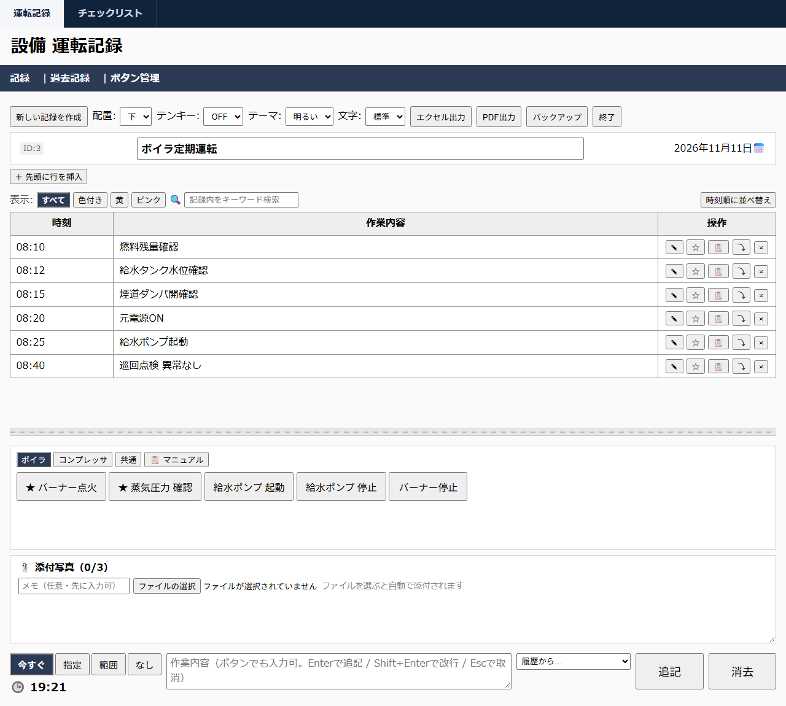

*上が記録の一覧、真ん中が入力ボタン、下が入力欄です。上下の境目はドラッグで広さを変えられます。*

1. **「新しい記録を作成」**を押し、タイトル（例：ボイラ定期運転）を入れると記録が始まります。左に「ID:番号」が付きます。
2. 下の入力欄に作業内容を書いて「追記」を押すと、1行増えます。時刻は「今すぐ」なら今の時刻が自動で入ります（「指定」「範囲」「なし」も選べます）。
3. 真ん中の**ボタン**を押すと、その文が1行で入ります。ボタンはグループ（ボイラ・コンプレッサ・共通 など）ごとにタブで切り替えます。
4. 行の右の操作ボタンで、編集・色付け（☆）・コピー・行の挿入・削除ができます。削除してもすぐ「元に戻す」で戻せます。
5. 色を付けた行は「表示：色付き／黄／ピンク」で絞り込めます。🔍の欄でキーワード検索もできます。
6. 「添付写真」に写真を3枚まで付けられます（メモも付けられます）。

**表示の調整**（PC・タブレットごとに覚えます）：配置（ボタンを下／右）・テンキー（画面の数字キー）・テーマ（明るい／暗い）・文字（標準／大／特大）

**出力**：「エクセル出力」「PDF出力」で、今の記録をファイルにします。「バックアップ」は今すぐ控えを取ります。

### 運転マニュアル（手順表）を押して記録する

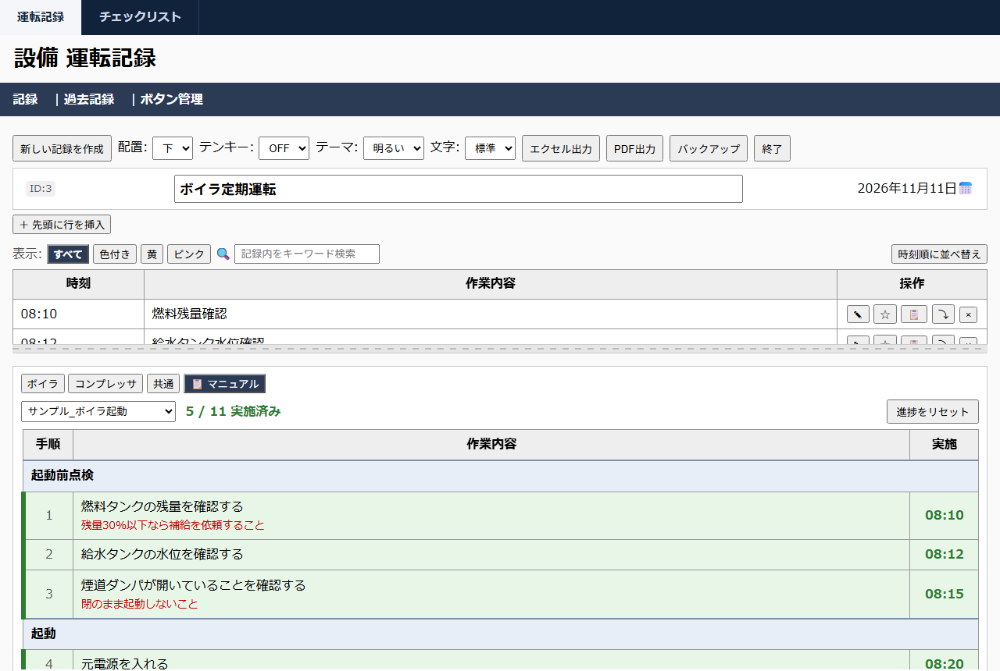

*実施した手順は緑色になり、右に実施時刻が出ます。*

- ボタン欄の「📋 マニュアル」タブを押すと、手順の表が出ます。手順が複数あるときは、左上のプルダウンで切り替えます。
- 手順の行を押すと、その時刻と内容が記録に1行入り、その手順が「実施済み」になります。押し間違えたときは、直後に出る「元に戻す」で取り消せます。
- どこまで進んだかは、ほかのPCにも同じように出ます。進み具合は記録ごとで、新しい記録ではまた最初からになります。
- 「進捗をリセット」は緑色と時刻だけを消します。記録した行は消えません。
- 手順表の作り方は [5章](#手順表運転マニュアルを作る) を見てください。

### 終了（確定）

一連の作業が終わったら**「終了」**を押します。記録が「確定」され、だれも編集できなくなります（ほかのPCの画面も数秒で切り替わります）。確定した記録を直すときは、管理者が確定を解除します（[6章](#6-管理者の操作)）。

### 過去記録

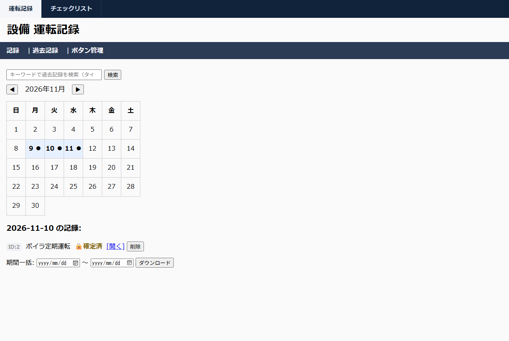

*記録のある日に●が付きます。日付を押すと、その日の記録が下に出ます。*

- 「過去記録」で、カレンダーから記録を探します。上の欄でキーワード検索もできます。
- 「[開く]」で、その記録を見るだけの画面で開きます。
- 「期間一括」で、期間を決めてまとめて Excel に出力できます。

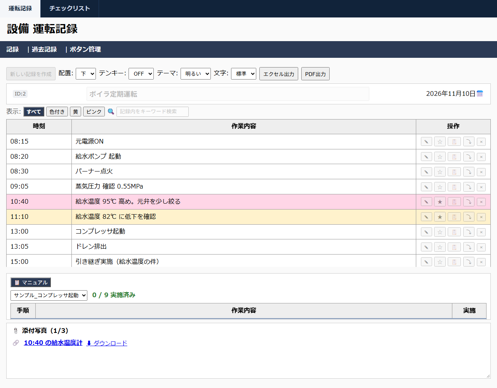

*確定済みの記録は灰色になり、編集できません。色付けした行や添付写真も見られます。*

### ボタン管理

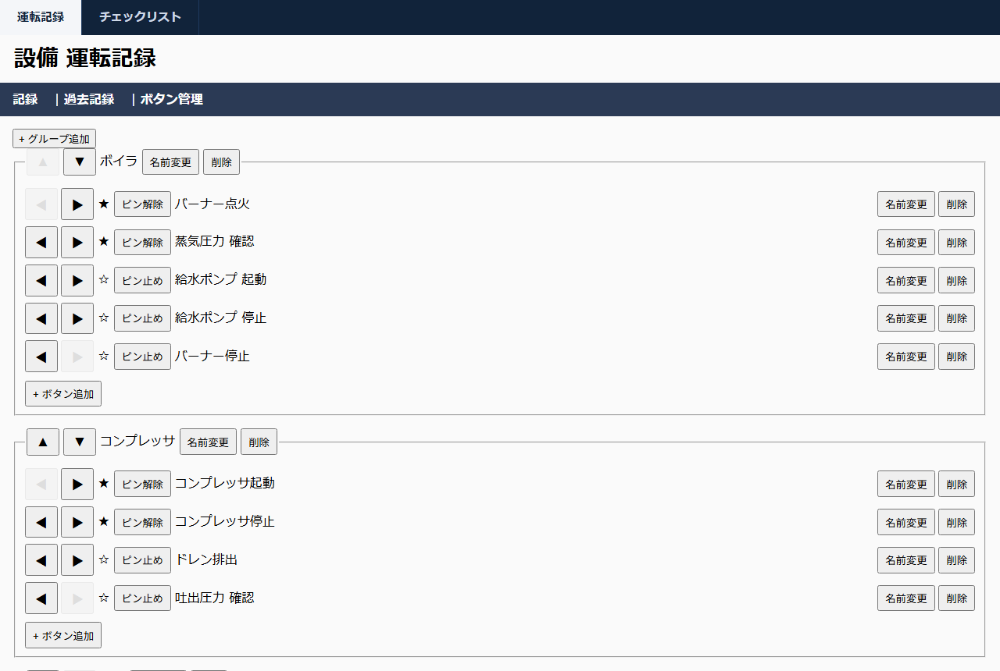

*グループとボタンの追加・名前変更・並べ替え・削除ができます。*

- 「ピン止め」したボタンには★が付きます。並び順は ◀ ▶ で変えられます。
- ここでの変更は、すぐに記録の画面のボタンに反映されます。

## 4. 点検チェックリストの使い方

### 点検の入力

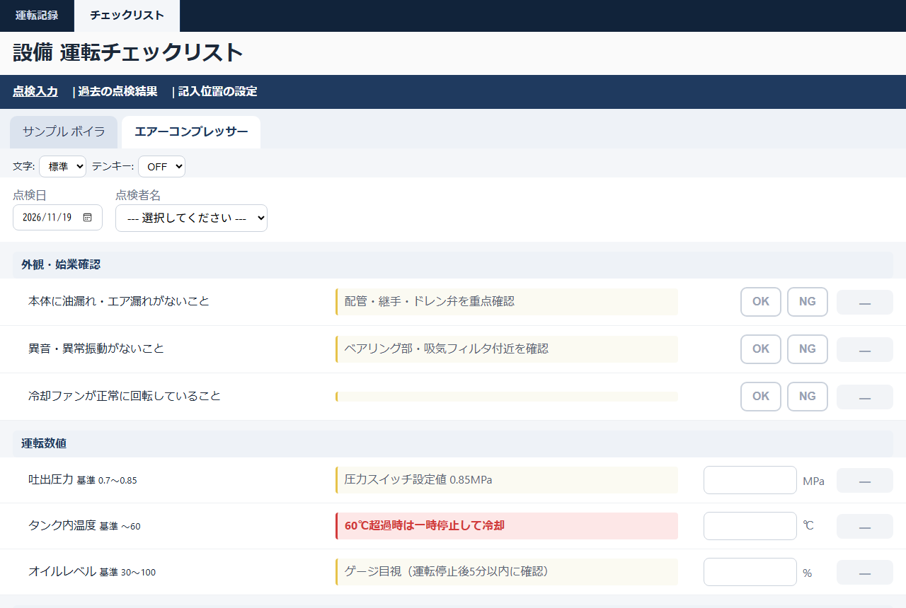

*設備は上のタブで切り替えます。*

1. 「点検日」と「点検者名」を選びます。
2. 項目ごとに入力します。

| 項目の種類 | 入れ方 |
|---|---|
| チェック | 「OK」「NG」を押します（もう一度押すと取り消し）。 |
| 数値 | 数字を入れます。「基準」の範囲外は自動で NG になり、色が変わります。 |
| 累計メータ | 「使用前」「使用後」の読みを入れると、当日の使用量を計算します。使用前には、前回の使用後が自動で入ります。 |
| 時刻 | 時刻を入れるか、「現在時刻」を押します。 |
| 計算 | ほかの項目から自動で計算します（入力は要りません）。 |

3. **「点検を保存」**で保存します。入れていない項目があると、「このまま保存しますか？」と確かめます。
4. 途中でやめるときは「一時保存」を押します。次に開いたときに続きから入力できます。

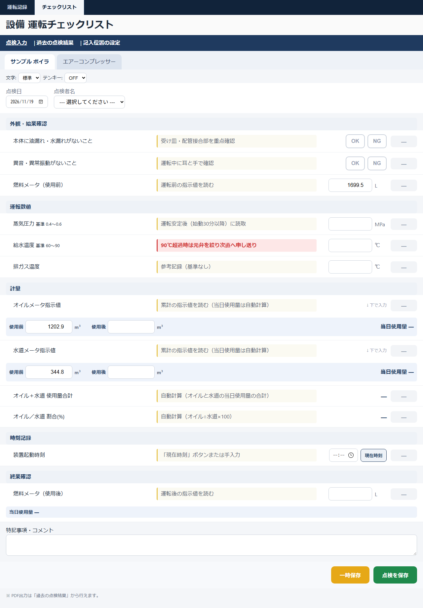

*備考が赤い太字の項目は、特に大事な注意点です。*

- **1日1回**：1つの設備の点検は1日1回です。保存すると、その日は「本日のチェックは終了しました」と出て、入力できなくなります。同じ日・同じ設備の点検は、ほかのPCからも重ねて保存できません。
- 文字の大きさは、左上の「文字」で変えられます。

### テンキーで数値を入れる（タブレット向け）

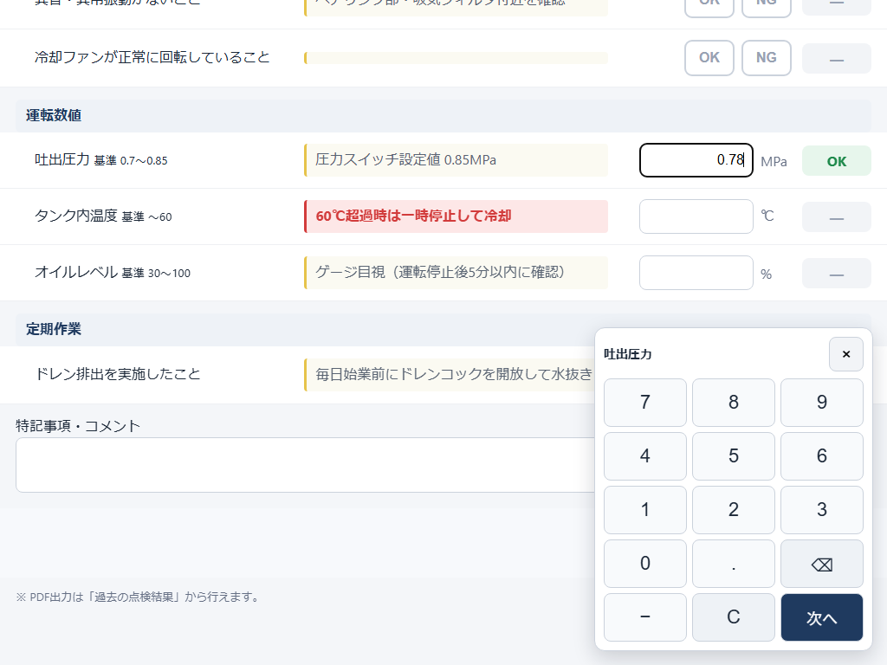

*数値の欄を押すと、画面の右下にテンキーが出ます。上に、今入れている項目の名前が出ます。*

- 左上の「テンキー」を **ON** にすると、数値の欄（数値・累計メータ）を押したときに、画面のテンキーが出ます。タブレットのキーボードは出ません。
- 「.」で小数点、「−」でマイナス、「⌫」で1文字消す、「C」で全部消す、です。
- **「次へ」**で、次の数値の欄に移ります。最後の欄で押すと、テンキーが閉じます。
- 「×」で閉じます。ほかの欄（時刻・コメントなど）を押したときも閉じます。
- ON／OFF は、その PC・タブレットごとに覚えます。パソコンでは OFF のままキーボードで入力できます。
- 時刻の欄は、テンキーではなく「現在時刻」ボタンか、端末の時刻の入力を使います。

### 過去の点検結果

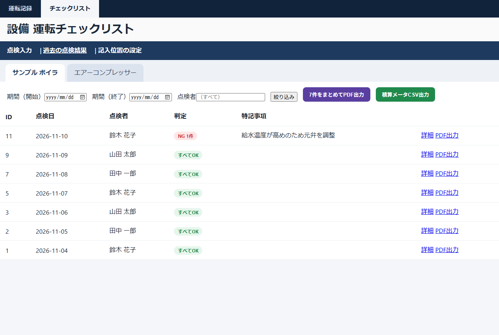

*NG があった日は赤く「NG 1件」と出ます。*

- 期間・点検者で絞り込めます。
- 「詳細」で中身を見られます。「PDF出力」で、その日の点検を様式PDFに記入した形で出力します。
- 「N件をまとめてPDF出力」で、絞り込んだ日の分を1つのPDFにまとめます。
- 「積算メータCSV出力」で、メータの使用量を期間ごとに Excel で開けるCSVにします。

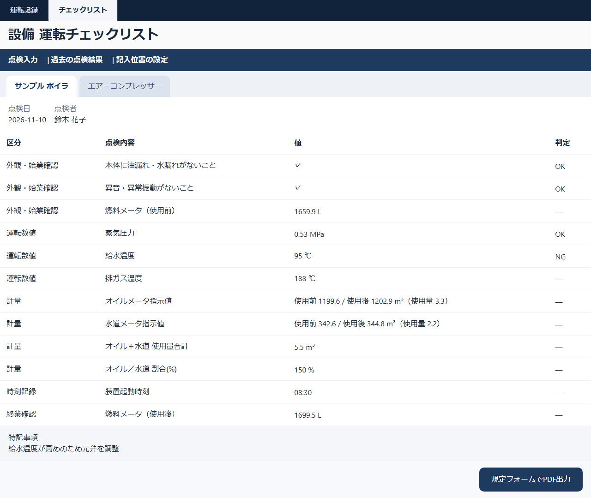

*メータは使用前・使用後と使用量を並べて出します。*

### 様式PDFへの出力

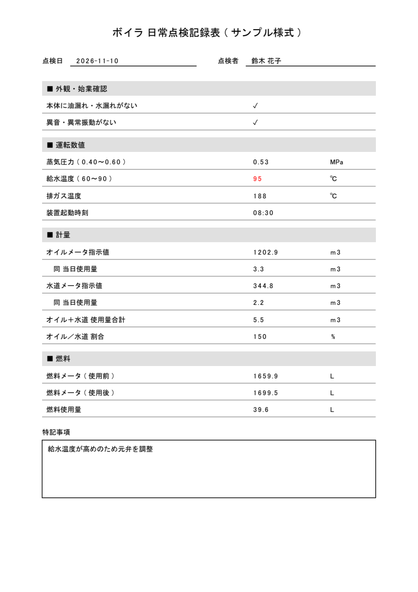

*範囲外の値（この例では給水温度 95℃）は赤い字で記入できます。*

### 記入位置の設定

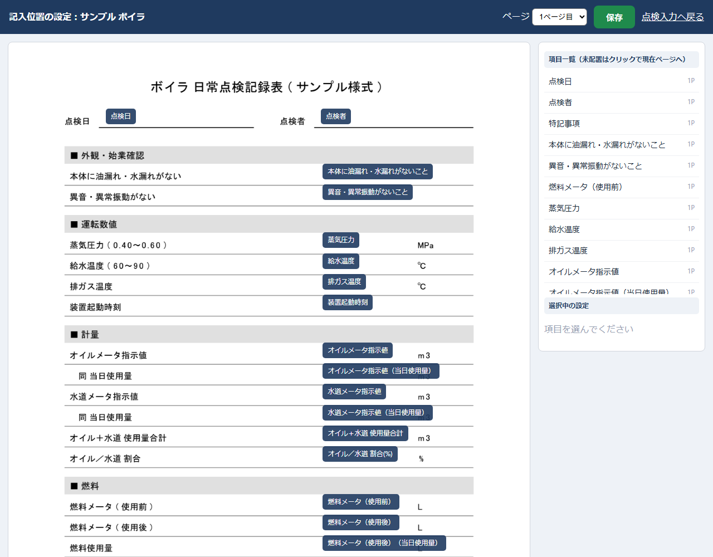

*左の様式の上で、項目の札をドラッグして置き場所を決め、「保存」を押します。*

- 右の「項目一覧」の項目を押すと、今のページに札が出ます。
- 札を選ぶと、右下で文字の大きさと色を決められます。数値の項目は、範囲外（NG）のときの色も決められます。
- 位置を変えたあとは、「過去の点検結果」から PDF を出して確かめてください。

## 5. 自分の職場に合わせる

ファイルはメモ帳や Excel で直せます。文字コードは UTF-8・Shift-JIS のどちらでも読めます。

| 直したいもの | ファイル | 反映のしかた |
|---|---|---|
| 運転記録の題名 | `work\app_title.txt`（1行目） | ページの再読み込み |
| チェックリストの題名 | `check\title.txt`（1行目） | サーバーの再起動 |
| 点検者の名前 | `check\inspectors.csv`（1行目は「氏名」、2行目から1人1行） | ページの再読み込み |
| 設備と点検項目 | `check\equipments\<設備名>\`（下を参照） | ページの再読み込み |
| 運転マニュアル | `work\manuals\<名前>.csv`（下を参照） | ページの再読み込み |
| ポート番号 | `config.json` の `"port"` | サーバーの再起動 |

### 設備を足す

`check\equipments\` の中に設備ごとのフォルダがあります。付属のサンプル（`sample_boiler` など）を**フォルダごとコピーして、中身を書き換える**のがいちばん簡単です。

| ファイル | 中身 |
|---|---|
| `equipment.json` | 画面に出る設備名（`name`）と並び順（`order`） |
| `checklist.csv` | 点検項目。1行＝1項目 |
| `form.pdf` | 職場の様式PDF（自分の様式に差し替えます） |
| `mapping.json` | 様式に記入する位置。画面の「記入位置の設定」で作ります |

`checklist.csv` の列は次のとおりです。

| 列 | 中身 |
|---|---|
| 区分 | 見出し（外観・始業確認 など） |
| 点検内容 | 項目名。ほかの行と同じ名前にしないでください |
| 種別 | `check`（OK/NG）・`number`（数値）・`meter`（累計メータ1行）・`meter_before` / `meter_after`（累計メータを使用前・使用後の2行に分ける）・`time`（時刻）・`calc`（計算） |
| 単位 | ℃・MPa・L など（自由） |
| 下限・上限 | 数値の基準。範囲外は NG |
| 備考 | 注意点（入力画面に出ます） |
| 重要 | ○ を入れると、備考が赤い太字になります |
| メータ組 | `meter_before` と `meter_after` を組にする名前（両方の行に同じ名前を入れます） |
| 計算式 | `calc` の式。例：`{オイルメータ指示値} + {水道メータ指示値}`（ほかの項目は { } で囲みます。使える記号は ＋ − ＊ ／ と括弧） |

書き方を間違えると、点検の画面に赤字で「何行目がどう悪いか」が出ます。直してから再読み込みしてください。

### 手順表（運転マニュアル）を作る

`work\manuals\` に CSV を置くと、運転記録の「📋 マニュアル」に出ます。付属の `サンプル_ボイラ起動.csv` を見本にしてください。1行目は次の5列にします。

```
区分,手順,作業内容,備考,記録内容
起動,1,元電源を入れる,,元電源ON
起動,2,給水ポンプを起動する,圧力が0.3MPa以上になるまで待つ,給水ポンプ起動
```

| 列 | 中身 |
|---|---|
| 区分 | 見出し（同じ区分の行はまとめて1つの見出しになります） |
| 手順 | 番号（空でも可） |
| 作業内容 | 表に出る文（必須。行ごとに違う文にします） |
| 備考 | 注意点。赤い小さな字で出ます |
| 記録内容 | 押したときに記録に入る文。空なら作業内容がそのまま入ります |

進み具合は「作業内容」の文で覚えています。途中で作業内容を書き換えると、その手順は未実施に戻ります。

### サンプルの様式を作り直す

付属の2設備の様式PDFと記入位置は、次のコマンドで作り直せます（自分の設備には使いません）。

```
.venv\Scripts\python.exe check\tools\make_sample_form.py
```

## 6. 管理者の操作

管理者の操作は、**サーバーPCで** .bat ファイルを実行して行います。

### 確定した運転記録を直す

1. `管理者_確定解除.bat` を実行します。
2. 直したい記録の ID（過去記録の一覧に出ます）を入れます。`確定解除リスト.txt` に ID を書いて、何も入れずに Enter でも構いません。
3. アプリで記録を開いて直し、もう一度「終了」を押します。

### 保存した点検結果を直す・消す

1. `管理者_点検修正解除.bat` を実行します。
2. 直したい点検の ID（過去の点検結果の ID 列）を入れます。`点検修正リスト.txt` にも書けます。削除もここからできます。
3. 一覧に出る「✏修正」から直して、「点検を保存」を押します（保存すると、また編集できない状態に戻ります）。

### ほかのPCのデータを取り込む

1. サーバー（黒い画面）を止めます。
2. `他PCデータ取込.bat` を実行し、取り込みたいデータのファイル（`work.db` や `check.db`）を黒い画面にドラッグして Enter を押します。
3. 取り込む前のデータは、`data` フォルダに日時付きの名前で自動で控えます。

### ほかのPCのアプリを新しい版にする

1. 新しい版のフォルダをそのPCにコピーし、その中の `アプリ更新.bat` を実行します。
2. 更新したいアプリのフォルダ（`run.py` があるほう）を黒い画面にドラッグして Enter を押します。
3. プログラムだけを入れ替えます。記録・設定・設備・手順表・題名・点検者は、そのまま残ります。
4. **新しい版で使う部品が増えたときは、そのPCで `初回セットアップ.bat` をもう一度実行してください**（インターネットが必要です）。

### テストのときだけ「1日1回」を外す

`config.json` の `"checklist_test_mode"` を `true` にすると、同じ日に何度でも点検を保存できます（画面に「テストモード」と出ます）。**本番では必ず `false` に戻してください。**

## 7. データの保存場所とバックアップ

| データ | 場所 |
|---|---|
| 運転記録・ボタン・手順の進み具合 | `data\work.db` |
| 添付写真 | `uploads` フォルダ |
| 点検結果 | `data\check.db` |
| 編集ログ | `data\audit_log.csv`（Excel で開けます。`編集ログを開く.bat` でも開けます） |
| 出力したPDF | `output` フォルダ |
| 自動バックアップ | `backup` フォルダ（1日1回、`records_日付.db` と `check_日付.db` を作り、90日分残します） |

PCを入れ替えるときは、`data` と `uploads` フォルダをコピーすれば記録を引き継げます。

## 8. 困ったとき

| 困りごと | 対処 |
|---|---|
| `起動.bat` がすぐ閉じる | Python が入っていないか、PATH の設定がありません。Python を入れ直し、`初回セットアップ.bat` をもう一度実行してください。 |
| 「ポート 6060 は既に使用中です」と出る | アプリがすでに起動しています。開いている黒い画面をすべて閉じてから、もう一度起動してください。直らなければ `config.json` の `"port"` を別の番号にします。 |
| ほかのPCから開けない | サーバーPCのIPアドレスと、ファイアウォールの許可を確かめてください。 |
| 画面が変わらない | ブラウザで Ctrl+F5 を押してください。題名などのファイルを直したときは、表の「反映のしかた」も見てください。 |
| 点検の画面に赤字のエラーが出る | `checklist.csv` の書き方を確かめてください（種別のつづり、計算式の { }、メータ組の名前がそろっているか）。 |
| 記入位置の設定で様式が出ない | 新しい版に更新したPCでは、`初回セットアップ.bat` をもう一度実行してください。 |
